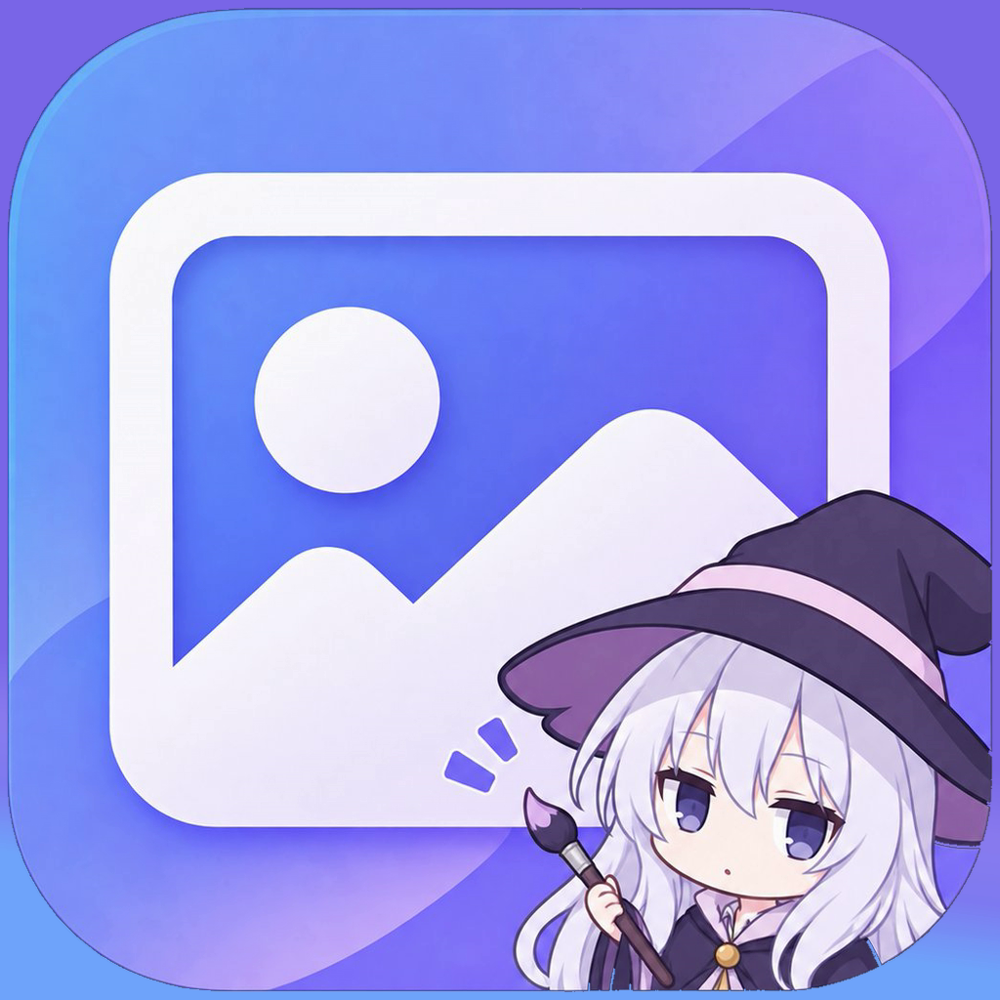

<p align="center">
  
</p>

# Galeri FRM

Galeri foto & video gaya Samsung Gallery, dengan isi dari Google Drive.
Folder Drive tampil sebagai album; foto, video, dan musik bisa dibuka,
diputar, dan dikelola langsung dari aplikasi.

Kode orisinal — tampilannya terinspirasi Samsung Gallery, tapi tidak
mengandung kode Samsung apa pun.

## Fitur

- **Timeline ala Samsung**: cubit untuk ganti level (hari, minggu, dst.)
- **Album** dari folder Drive, plus tab musik
- **Penampil foto**: Favorit · Ubah · Putar · Rincian · Berbagi · Hapus, dengan Rotate
- **Pemutar video** dengan mode musik (tampilan pemutar musik, videonya tetap jalan di kotak cover)
- **Pemutar musik** dengan cover lagu, seek, shuffle/repeat
- **Multi-akun Drive**: tambah beberapa akun Google, semua album digabung
- **Login manual** per akun via OAuth loopback (browser → 127.0.0.1), token disimpan lokal di HP

## Build

Butuh Android Studio (atau JDK 17 + Android SDK) dan koneksi internet
untuk mengunduh dependensi dari Google Maven / Maven Central.

```sh
cp local.properties.example local.properties
# isi drive.clientId + drive.clientSecret di local.properties (lihat bawah)
./gradlew assembleRelease
```

APK hasil build ada di `app/build/outputs/apk/release/`.
Build debug (`assembleDebug`) pakai kunci debug bawaan Android Studio.
Untuk rilis yang bisa di-update, tambahkan `signingConfig` sendiri —
jangan pernah commit keystore ke repo.

## Setup OAuth Drive

Aplikasi ini tidak membawa kredensial Google apa pun. Setiap yang build
harus pakai OAuth client-nya sendiri:

1. [Google Cloud Console](https://console.cloud.google.com/) → buat project
   → aktifkan **Google Drive API**.
2. **OAuth consent screen** → isi info aplikasi.
3. **Credentials → Create Credentials → OAuth client ID** → tipe **Desktop app**.
4. Salin **Client ID** dan **Client Secret** ke `local.properties`:
   `drive.clientId` dan `drive.clientSecret`.
5. Login dari menu aplikasi; tiap akun login pakai akun Google-nya sendiri.

Tanpa kredensial ini, login Drive tidak bisa jalan (tombol login akan gagal
di langkah otorisasi Google) — fitur lokal lain tetap jalan.

## Catatan

- **Dependensi**: `app/libs/jaudiotagger.jar` disertakan karena dibutuhkan
  untuk membaca/menulis cover lagu (lihat lisensi jaudiotagger di hulu).

## Lisensi

MIT — lihat `LICENSE`.
