<p align="center">
  
</p>

<p align="center">
  <a href="https://github.com/frmdeveloper/gallery/releases/download/v1.91/GaleriFRM-v1.91.apk">
    
  </a>
  <br />
  <sub><a href="https://github.com/frmdeveloper/gallery/releases">All releases</a></sub>
</p>

# Galeri FRM

A Samsung Gallery-style photo & video gallery powered by your Google Drive.
Drive folders show up as albums; photos, videos, and music can be browsed,
played, and managed right from the app.

Original code — the look is inspired by Samsung Gallery, but it contains no
Samsung code.

## Features

- **Samsung-style timeline**: pinch to switch zoom levels (day, week, …)
- **Albums** from Drive folders, plus a music tab
- **Photo viewer**: Favorite · Edit · Rotate · Details · Share · Delete
- **Video player** with a music mode (music-player layout, the video keeps
  playing inside the cover box)
- **Music player** with album art, seek, shuffle/repeat, and background
  playback
- **Multiple Drive accounts**: add several Google accounts, all albums are
  merged; each account row shows its remaining Drive storage
- **Sign-in through Google's own dialog** (the system account picker sheet,
  no browser); a loopback browser sign-in remains as a fallback for accounts
  that are not on the phone
- **Storage overview**: remaining space of the internal storage, SD card,
  and USB drives, in the same layout as the Drive accounts
- **In-app updates**: checks GitHub releases and installs the new APK
  directly
- **Liquid Glass theme**: iOS-style frosted glass surfaces over a soft
  mesh gradient, with a floating glass tab bar

## Screenshots

<table>
  <tr>
    <td align="center">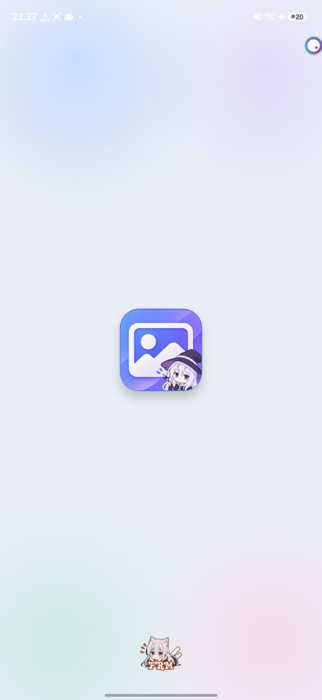<br /><sub>Splash screen</sub></td>
    <td align="center">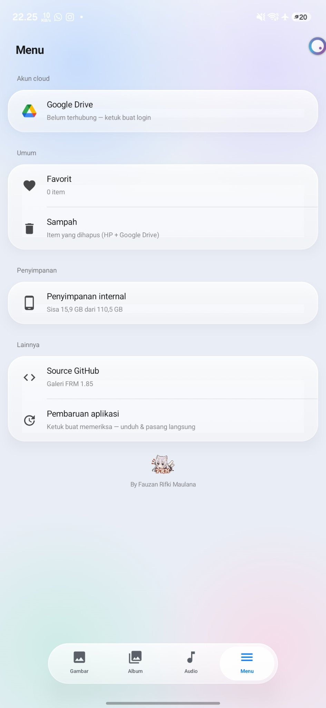<br /><sub>Menu</sub></td>
    <td align="center">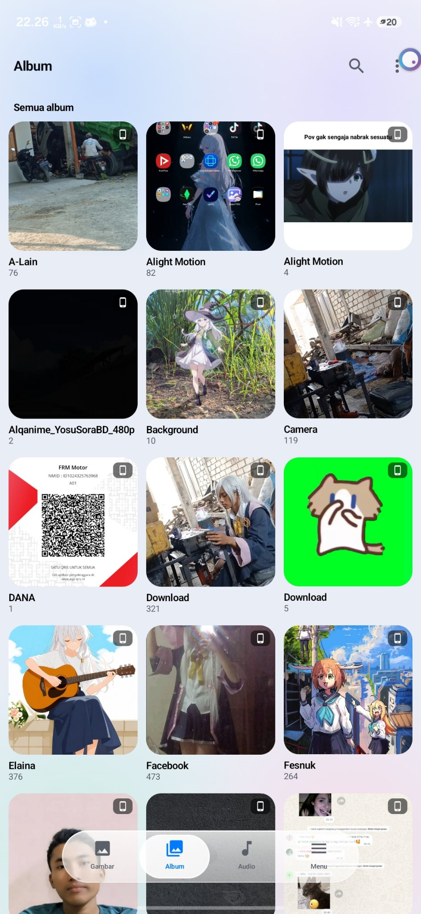<br /><sub>Albums · grid</sub></td>
  </tr>
  <tr>
    <td align="center">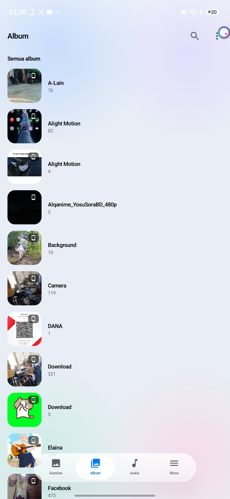<br /><sub>Albums · list</sub></td>
    <td align="center">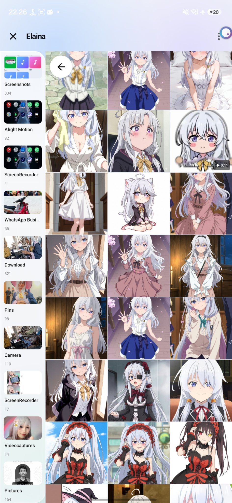<br /><sub>Album · side panel</sub></td>
    <td align="center">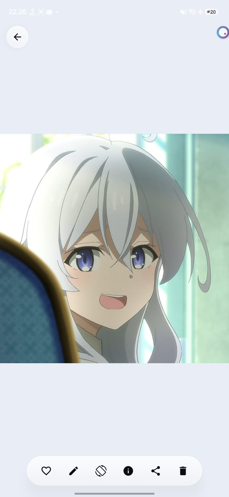<br /><sub>Photo viewer</sub></td>
  </tr>
  <tr>
    <td align="center">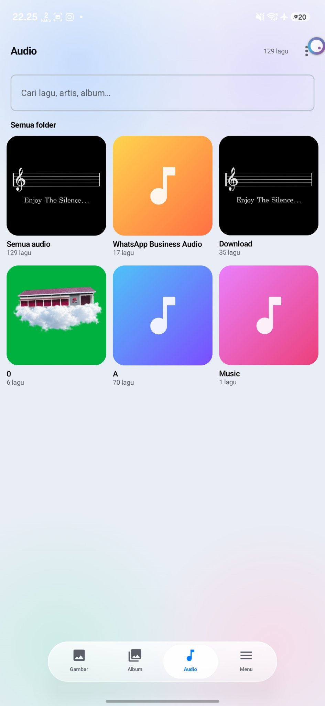<br /><sub>Audio folders · grid</sub></td>
    <td align="center">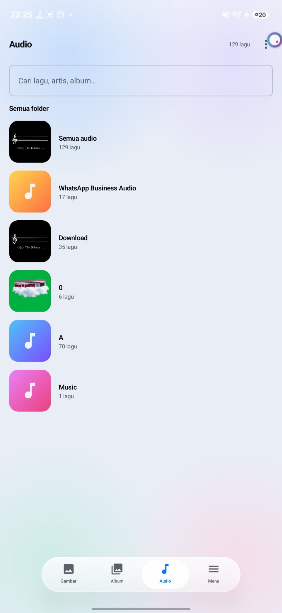<br /><sub>Audio folders · list</sub></td>
    <td align="center">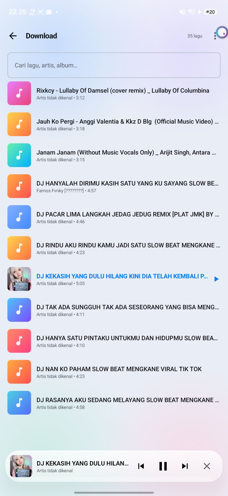<br /><sub>Tracks &amp; mini player</sub></td>
  </tr>
  <tr>
    <td align="center">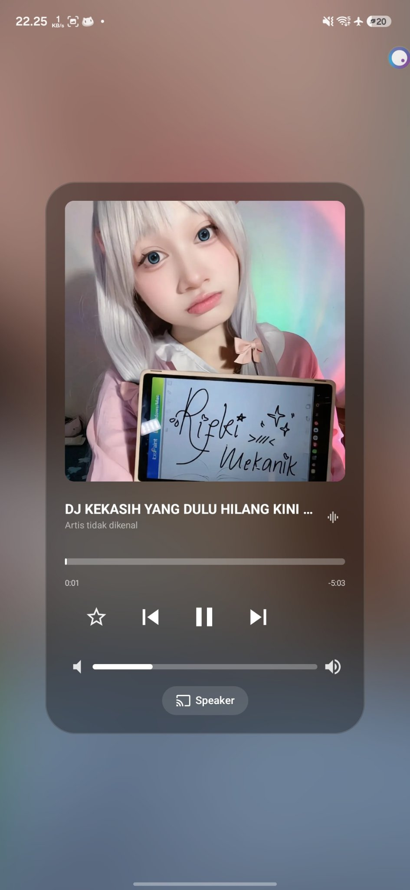<br /><sub>Music player</sub></td>
    <td align="center">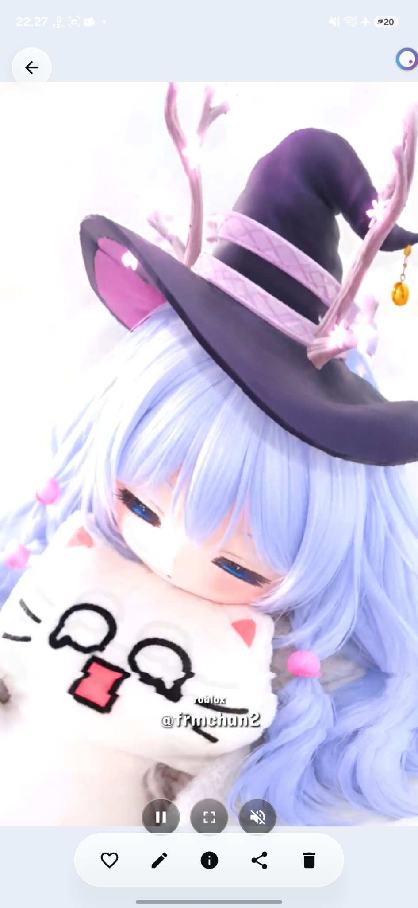<br /><sub>Video preview</sub></td>
    <td align="center">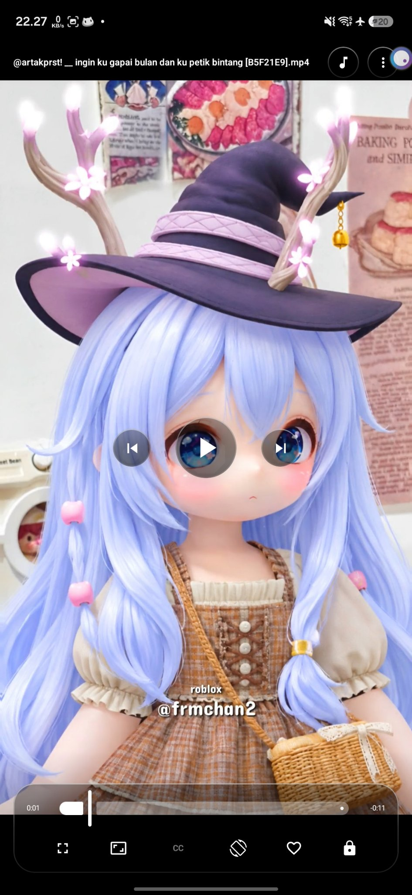<br /><sub>Video player</sub></td>
  </tr>
</table>

## Building

Requires Android Studio (or JDK 17 + the Android SDK) and an internet
connection to download dependencies from Google Maven / Maven Central.

```sh
cp local.properties.example local.properties
# fill in your own OAuth client values in local.properties (see below)
./gradlew assembleRelease
```

The APK lands in `app/build/outputs/apk/release/`.
Debug builds (`assembleDebug`) use Android Studio's built-in debug key.
For updatable release builds, add your own `signingConfig` — never commit a
keystore to the repo.

## Google Drive OAuth setup

The app ships without any Google credentials. Everyone who builds it has to
use their own OAuth clients:

1. [Google Cloud Console](https://console.cloud.google.com/) → create a
   project → enable the **Google Drive API**.
2. **OAuth consent screen** → fill in the app information.
3. **Credentials → Create Credentials → OAuth client ID**, create:
   - one **Desktop app** client (used by the loopback browser fallback),
   - one **Web application** client (used by the in-app Google dialog),
   - one **Android** client with package name `id.frmdeveloper.gallery` and
     your signing certificate's SHA-1 (required by the dialog).
4. Copy the **Desktop** and **Web** client IDs and secrets into
   `local.properties`: `drive.clientId` / `drive.clientSecret` and
   `drive.webClientId` / `drive.webClientSecret`.
5. Sign in from the app's Menu; every account signs in with its own Google
   account.

Without these credentials, Drive sign-in cannot work (sign-in fails at
Google's authorization step) — the local features keep working.

## Notes

- **Dependency**: `app/libs/jaudiotagger.jar` is bundled because it is
  needed to read/write song cover art (see the upstream jaudiotagger
  license).

## License

MIT — see `LICENSE`.
